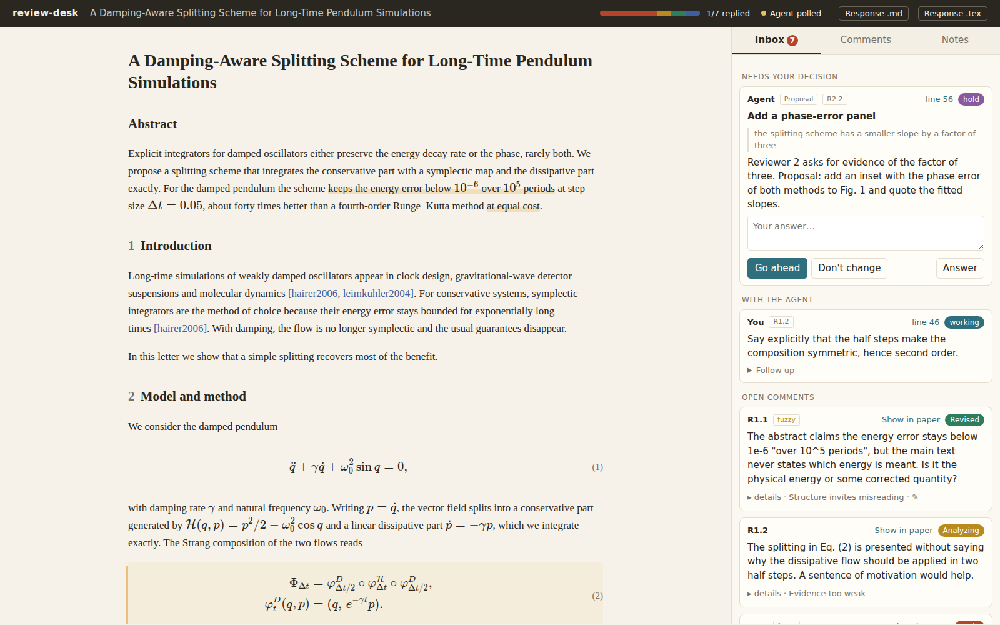
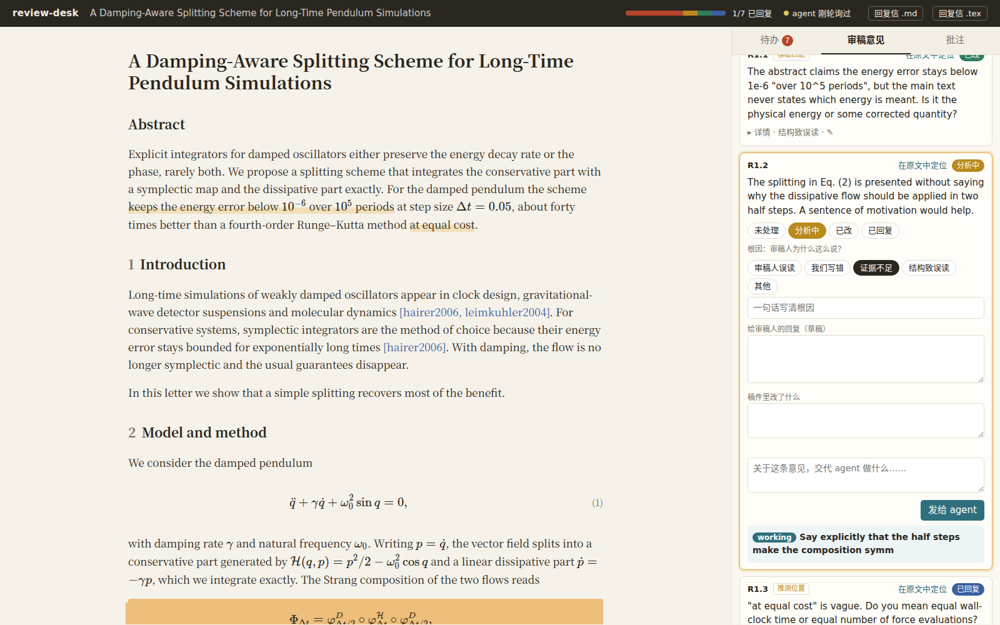

# review-desk

**Answer peer review with your coding agent: read the paper with the reviewers' comments in the margin, decide why each comment was made, send edits to the agent from the page, and draft the response letter as you go.**

[中文说明](#中文说明)



review-desk is a small local web app plus a CLI. It turns your LaTeX or
Markdown manuscript into a readable page, pins each reviewer comment to the
sentence it is about, and gives you and your AI coding agent (Claude Code,
Codex, ...) one shared file to work from. You select text, write what should
change, and the agent edits the source, updates the comment's record and
reports back on the page.

- Python 3.10+ standard library only. No build step, no account, no cloud.
- Works offline: KaTeX is bundled for the math.
- Listens on 127.0.0.1 only.

## 30-second start

```sh
git clone <this repo> review-desk && cd review-desk
pip install .                       # or: python -m review_desk ...

cd examples/synthetic               # an invented paper with invented reviews
review-desk serve                   # open http://127.0.0.1:8765/
```

For your own paper:

```sh
cd path/to/paper
review-desk init main.tex reviews.md    # writes review-desk.json
review-desk build                       # checks that every comment found its sentence
review-desk serve --open
```

Then tell your agent to follow `adapters/AGENT_INSTRUCTIONS.md` (copy it into
`CLAUDE.md` / `AGENTS.md`) and to run `review-desk wait`.

## The workflow it supports

| Step | On the page | Stored as |
|---|---|---|
| **Read** | The paper as HTML. Commented passages have a soft underline; click one to open its comment. Equations, figures and references render. | build output (derived) |
| **Judge** | Each comment gets a status (to do → analyzing → revised → replied) and a **root cause**: *reviewer misread*, *we wrote it wrong*, *evidence too weak*, *structure invites misreading*, *other*. | `review-state.json` |
| **Revise** | Select text → write a note → it goes to the agent. Or write an instruction on a comment card. The agent edits the source; the page rebuilds itself. | notes in `review-state.json` |
| **Reply** | A response draft and a "changes made" field per comment, written while revising, not at the end. Export a response-letter skeleton in Markdown or LaTeX. | `review-state.json` |
| **Track** | The inbox shows only what is open: agent proposals and questions waiting for you, notes the agent is working on, comments not yet replied. | |

The root cause is the useful part. A comment caused by *structure* (the
reviewer misread because the argument is in the wrong order) needs a
different fix than one caused by *we wrote it wrong*, and the pattern over
all comments tells you what to fix in the paper as a whole. The agent may
suggest a root cause; only you can mark a comment *replied*.

## Architecture

```
 ┌──────────────────────────────┐        ┌──────────────────────────────┐
 │ Page (static/app.html + JS)  │        │ Agent (Claude Code, Codex,…) │
 │ read · judge · note · reply  │        │ edits paper.tex / paper.md   │
 └──────────────┬───────────────┘        └──────────────┬───────────────┘
                │ HTTP (127.0.0.1)                      │ shell: review-desk wait|list|
                │                                       │        reply|propose|comment
 ┌──────────────▼───────────────────────────────────────▼───────────────┐
 │ Interface   server.py (HTTP API)        cli.py (CLI; falls back to    │
 │                                         the file if the server is     │
 │                                         unreachable, e.g. in a sandbox)│
 ├──────────────────────────────────────────────────────────────────────┤
 │ Core        core.py: mailbox (claim, reply, propose, answer, comment) │
 │             build.py: paper + reviews → blocks, anchors, report       │
 │             latex.py · markdown.py · reviews.py · export.py           │
 ├──────────────────────────────────────────────────────────────────────┤
 │ Storage     review-state.json  ← single source of truth for decisions │
 │             (atomic writes + file lock; humans and agents can read it)│
 │             paper.tex/.md, reviews.md/.json/.yaml  ← your inputs       │
 │             .review-desk/build.json  ← derived, rebuilt on change      │
 ├──────────────────────────────────────────────────────────────────────┤
 │ Config      review-desk.json: paper, reviews, state, port, lang,      │
 │             build_cmd                                                 │
 └──────────────────────────────────────────────────────────────────────┘
 Adapters (adapters/*.md): how each agent gets the instructions and which
 mode it runs in. Docs only; the CLI is the contract.
```

**Agent modes.** *Resident*: the agent runs `review-desk wait` in the
background; it exits when you send a note, which wakes the agent (Claude
Code does this). *Batch*: the agent runs `review-desk wait --no-block` once,
handles everything pending, and stops; use it for agents that cannot keep a
background process, or start it from a loop. When no agent is listening, the
page says so and shows the command to give your agent.

## Input formats

**Paper**: LaTeX (`.tex`; article/revtex-style: title, abstract, sections,
paragraphs, inline and display math with numbering, `\ref`/`\eqref`/`\cite`,
figures and tables as placeholders with captions, lists, simple
`\newcommand` macros) or Markdown (`.md`; headings, `$`/`$$` math, images,
lists, code). Figures in PNG/JPG/SVG next to the paper are shown; others
(PDF/EPS) appear as labelled placeholders.

**Reviews**, plain text or Markdown:

```markdown
## Reviewer 1
Comment 1: The abstract does not say how the energy error is measured.
@anchor: keeps the energy error below
Comment 2: ...

## Reviewer 2
1. Numbered items work too when there are no "Comment N" lines.
```

A comment is pinned to the paper by `@anchor:` lines: an exact substring of
the source (whitespace differences are tolerated). Without one, quoted
phrases of 12+ characters in the comment are tried (shown as "guessed
spot"). An anchor that no longer matches, because the sentence was rewritten,
is listed in the build report and on the page; nothing breaks.

Or JSON (YAML with `pip install pyyaml`):

```json
{"reviewers": [{"id": "1", "comments": [
  {"id": "1", "text": "…", "anchors": ["exact source text"]}]}]}
```

## Data format: `review-state.json`

```json
{
 "version": 1,
 "comments": {
  "R1.2": {"status": "revised", "root_cause": "structure",
           "root_cause_note": "argument order", "response": "We now …",
           "changes": "Sec. 2, first paragraph", "updated": "…", "updated_by": "agent"}
 },
 "notes": [
  {"id": "n3f2a…", "author": "user", "status": "done", "text": "Define E here.",
   "quote": "selected text", "block": "b12", "line": 46, "context": "source paragraph",
   "comment": "R1.2", "title": "Sec. 2: define E", "reply": "Added …", "thread": []}
 ]
}
```

Note status: `new` (sent) → `working` (claimed by the agent) → `done`, or
`hold` (the agent asks you, or proposes a change). Answering a note on the
page sends it back as `new`, with the exchange kept in `thread`.

## CLI

```
review-desk init PAPER [REVIEWS]   review-desk build [--strict]   review-desk serve [--open]
review-desk wait [--timeout S | --no-block]
review-desk list [--all] [--json]   review-desk show R1.2
review-desk reply ID --title T --reply R [--hold]
review-desk propose --title T --text X [--quote Q] [--comment R1.2]
review-desk comment R1.2 [--status S] [--root-cause C] [--response R] [--changes X]
review-desk export [--format md|tex] [-o FILE]
```

Every command accepts `--config`, `--port`, `--url` and `--offline` (work
on the state file without the server). `build_cmd` in the config (e.g.
`latexmk -pdf main.tex`) runs after `review-desk build`; the server never
runs it.

If you start the server on another port with `serve --port N`, give the
agent-side commands the same `--port N` (or `--url`); otherwise they find
no server on the default port and silently fall back to the offline state
file. Setting `"port"` in `review-desk.json` avoids this.

## Agent compatibility

| Agent | Mode | Status |
|---|---|---|
| Claude Code 2.1.312 | resident (background `wait`) | tested, works |
| Claude Code 2.1.312 | batch (`claude -p`) | tested, works |
| Codex CLI 0.164.0 | batch (`codex exec`, default sandbox) | tested, works via the offline fallback |
| Codex CLI | resident / polling | not tested |
| Kimi CLI, OpenCode, Mimo Code, Qwen Code, Claude Code with GLM/Kimi/DeepSeek models | | not tested; guide in `adapters/generic.md` |

Details and test records: [docs/adapters.md](docs/adapters.md).

## Security

- Binds to 127.0.0.1 only. Requests must carry a local `Host` header (stops
  DNS rebinding). POSTs must be JSON from the page's own origin (stops other
  websites from posting into your mailbox); there is no CORS, so other sites
  cannot read your reviews either.
- Serves only the bundled static files and the figure files the paper
  names (image types, inside the paper's folder). No directory listing, no
  arbitrary paths.
- The server never runs shell commands. The agent runs with whatever
  permissions you give it; review-desk adds none.
- There is no authentication: anyone with a shell on your machine can use
  it, as with any local dev server. Do not expose the port.
- Your manuscript and reviews are confidential. Nothing leaves your machine
  through review-desk; what your agent sends to its model provider is
  between you and that provider.

## Limitations

- The LaTeX converter is for reading, not typesetting. Custom environments
  show as plain text, `\input` files are not followed, tables become
  placeholders, macros with arguments are expanded only in text, and
  bibliographies are omitted. Check the PDF for layout.
- Anchors are exact source substrings. After heavy rewriting, anchors go
  stale; the build report tells you which.
- One paper per server. One agent at a time is assumed (several can work,
  but they will share the inbox).
- Tested on Linux (WSL2) with Chrome. macOS, native Windows and other
  browsers: not tested.

## Development

```sh
python -m pytest            # or: python -m unittest discover -s tests
scripts/screenshots.sh      # regenerate docs/img (needs Chrome/Chromium)
```

Tests cover the parsers, anchoring (exact, whitespace, stale, math-crossing,
overlapping), the HTTP API, the security checks, the CLI round trip with a
real server process, the offline fallback and concurrent writers.

## Origin

review-desk generalizes a setup a physicist built while answering a second
round of peer review with an AI coding agent: an annotated HTML version of
the manuscript, a local mailbox the page writes to, and a CLI the agent
blocks on. The first version kept everything in one YAML file (comments →
issues → decisions → tasks → evidence → response); this one keeps that idea
of a single source of truth and drops the domain-specific parts.

## License

MIT. KaTeX (bundled in `review_desk/static/vendor/katex`) is MIT-licensed,
see its `LICENSE`.

---

## 中文说明

**review-desk：和 AI 编程 agent 一起回复审稿意见的本地工作台。** 论文（LaTeX 或 Markdown）渲染成网页，审稿意见挂在对应句子旁；每条意见记录状态和**根因**（审稿人误读 / 我们写错 / 证据不足 / 结构致误读 / 其他）；在网页上选中文字写批注，批注进入本地信箱，agent（Claude Code、Codex 等）取走后改源文件、更新该意见的回复草稿、在网页上回报；最后导出回复信骨架（Markdown / LaTeX）。

- 只依赖 Python 3.10+ 标准库；KaTeX 已内置，离线可用；只监听 127.0.0.1。
- 单一事实源：`review-state.json`，人和 agent 都能读写（原子写入 + 文件锁）。
- 两种 agent 模式：**常驻**（agent 后台跑 `review-desk wait`，有批注即被唤醒）和**批处理**（agent 执行一次 `review-desk wait --no-block` 处理全部待办）。沙箱禁网时 CLI 自动改为直接读写状态文件。
- 已实测：Claude Code 2.1.312（常驻、`claude -p` 批处理），Codex CLI 0.164.0（`codex exec` 批处理，走离线回退）。Kimi CLI、OpenCode、Mimo Code、Qwen Code 及接入 GLM/Kimi/DeepSeek 模型的 Claude Code **未测试**，适配思路见 `adapters/generic.md`。

上手：

```sh
pip install .
cd examples/synthetic && review-desk serve     # 打开 http://127.0.0.1:8765/
```

自己的论文：`review-desk init main.tex reviews.md`，`review-desk build` 检查锚点，`review-desk serve`；把 `adapters/AGENT_INSTRUCTIONS.md` 放进 `CLAUDE.md` / `AGENTS.md`，让 agent 运行 `review-desk wait`。界面语言在 `review-desk.json` 里设 `"lang": "zh"`。用 `serve --port N` 换端口时，agent 侧命令也要加 `--port N`（或 `--url`），否则会找不到服务器、落到离线状态文件回退；更省事的是在 `review-desk.json` 里设 `"port"`。


